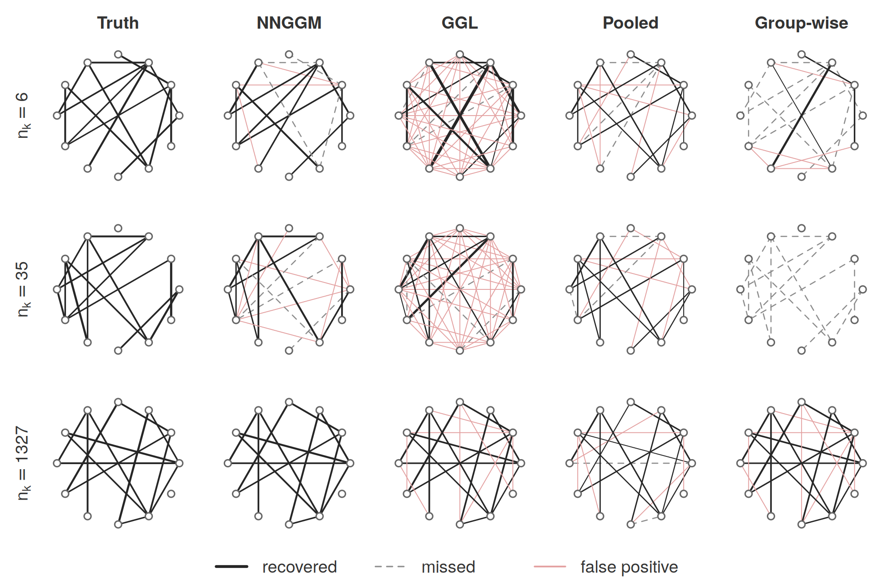
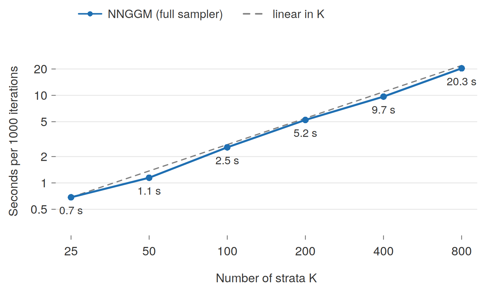
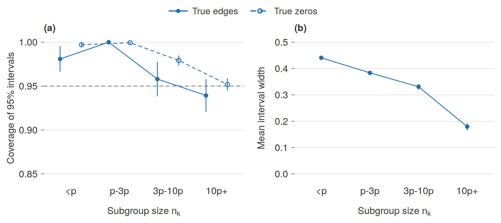

# NNGGM: Nearest-Neighbor Gaussian Graphical Model

Scalable Bayesian estimation of many related networks, developed in my PhD dissertation in Biostatistics at Drexel University (Dornsife School of Public Health).

## The problem
Health data are often split into many subgroups, for example by age, sex, race and ethnicity, or comorbidity, and each subgroup can have its own network of conditional dependencies among clinical variables. Fitting one network per subgroup is too noisy when the groups are small. Pooling the groups hides real differences between them. Existing joint estimators also become slow as the number of groups grows.

## The idea
Each subgroup's network borrows strength only from a small set of its most similar ("nearest-neighbor") subgroups, rather than from every other subgroup. This keeps the subgroup-specific structure, stabilizes estimates for small groups, and makes the computational cost grow roughly linearly in the number of groups. Inference is fully Bayesian, so every edge comes with uncertainty. Posterior sampling uses an MCMC sampler written in C++ (Rcpp).

## Results (simulation study)
**Edge recovery** compared with pooled, group-wise and joint graphical lasso:

**Gains are largest for small subgroups:**

**True vs. estimated networks:**

**Runtime scales close to linearly in the number of groups:**

**Credible-interval coverage:**

## Skills used
Bayesian modeling · MCMC (Metropolis-within-Gibbs) · R · Rcpp/C++ · R Shiny · simulation study design · high-dimensional statistics

## Status
The method paper is in preparation. Code will be released after publication and is available on request for recruiters and collaborators.

© 2026. All rights reserved. Figures may not be reused without permission.
