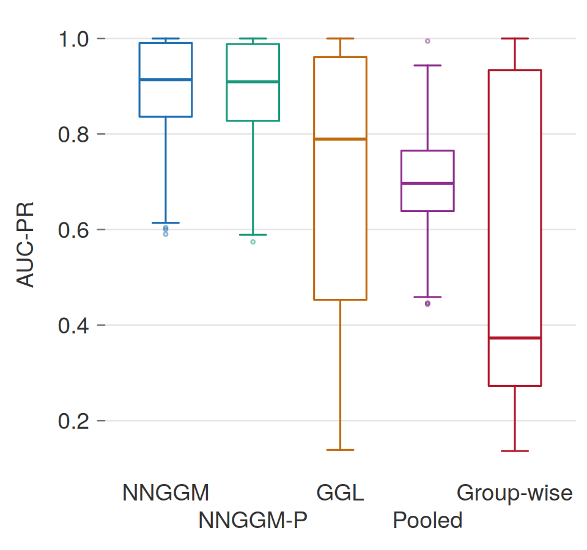
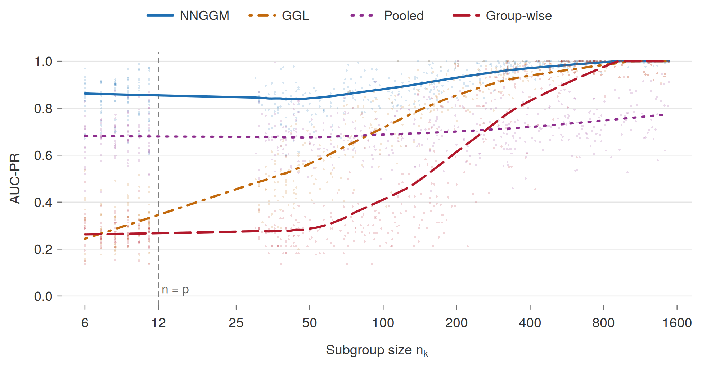

# NNGGM: Nearest-Neighbor Gaussian Graphical Model

Scalable Bayesian estimation of many related networks, developed in my PhD dissertation in Biostatistics at Drexel University (Dornsife School of Public Health).

## The problem
Health data are often split into many subgroups, for example by age, sex, race and ethnicity, or comorbidity, and each subgroup can have its own network of conditional dependencies among clinical variables. Fitting one network per subgroup is too noisy when the groups are small. Pooling the groups hides real differences between them. Existing joint estimators also become slow as the number of groups grows.

## The idea
Each subgroup's network borrows strength only from a small set of its most similar ("nearest-neighbor") subgroups, rather than from every other subgroup. This keeps the subgroup-specific structure, stabilizes estimates for small groups, and makes the computational cost grow roughly linearly in the number of groups. Inference is fully Bayesian, so every edge comes with uncertainty. Posterior sampling uses an MCMC sampler written in C++ (Rcpp).

## Results (simulation study)
Simulated data: K = 50 subgroups, p = 12 variables, and subgroup sizes from 6 to about 1,600. Each subgroup has its own true network. Results are pooled over 10 replicates. NNGGM is compared with three standard approaches:
- **Pooled:** one graphical lasso fit on all the data combined.
- **Group-wise:** a separate graphical lasso fit for each subgroup.
- **GGL:** the group joint graphical lasso.

### 1. Overall edge recovery

Each box shows AUC-PR (area under the precision–recall curve, where 1 means every true edge is ranked above every non-edge) across all subgroups and replicates. NNGGM and its faster pilot version (NNGGM-P) reach a median of about 0.91 with a tight spread. GGL (median about 0.79) and Group-wise (about 0.37) vary widely from subgroup to subgroup. Pooled is consistent but stuck near 0.70, because it ignores real differences between subgroups.

### 2. Where the gain comes from: small subgroups

Smoothed AUC-PR against subgroup size (log scale). The dashed line marks n = p, below which a subgroup has fewer observations than variables. In that range NNGGM stays at about 0.85, while Group-wise and GGL drop to about 0.25–0.35, because borrowing from similar neighbor subgroups fills in what a small sample can't estimate alone. As subgroups grow, every subgroup-specific method converges to near-perfect recovery. Pooled never does.

### 3. What the networks look like

Estimated networks for three subgroups (n = 6, 35 and 1,327) compared with the truth:
- **Black:** correctly recovered edges.
- **Dashed grey:** missed edges.
- **Pink:** false positives.

For the small subgroups, GGL produces many false edges and Group-wise misses almost everything, while NNGGM recovers most of the true structure. With n = 1,327, NNGGM recovers the network exactly.

### 4. Scales linearly in the number of subgroups

Seconds per 1,000 MCMC iterations as the number of subgroups K grows from 25 to 800 (log–log axes). Runtime tracks the dashed linear-in-K reference line, going from 0.7 s at K = 25 to 20.3 s at K = 800, because each subgroup borrows only from a fixed number of neighbors.

### 5. Uncertainty quantification

**(a)** Empirical coverage of the 95% posterior credible intervals for the partial correlations, shown separately for true edges and true zeros, by subgroup size. Coverage is at or above the nominal 95% (dashed line) in small and moderate subgroups, and slightly below it (about 0.94) for true edges in the largest subgroups.
**(b)** Intervals narrow as subgroups grow, so the model is honest about how much each subgroup's data can support.

## Interactive app
**[Live demo: NNGGM neighbor-study explorer](https://lizsul.shinyapps.io/nnggm-neighbor-study/)** (R Shiny)

Browse the simulation's neighbor structure: the neighbor DAG (click a group to select it), each group's true vs. estimated network, side-by-side comparisons of neighbor-selection rules and distances, and a radius explorer that recomputes neighbor sets on the fly.

## Skills used
Bayesian modeling · MCMC (Metropolis-within-Gibbs) · R · Rcpp/C++ · R Shiny · simulation study design · high-dimensional statistics

## Status
The method paper is in preparation. Code will be released after publication and is available on request for recruiters and collaborators.

© 2026. All rights reserved. Figures may not be reused without permission.
